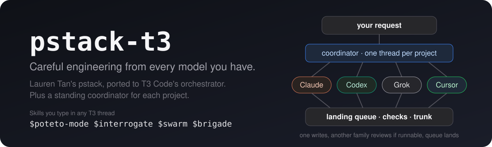
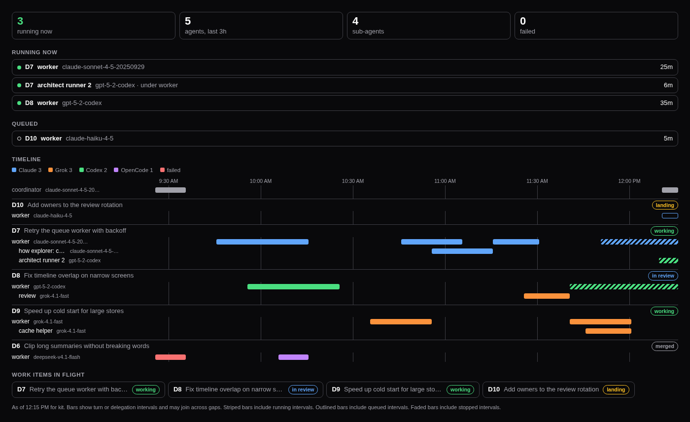

  

  
  
  
  

  <a href="docs/guide.md">Guide</a> ·
  <a href="docs/skills.md">All skills</a> ·
  <a href="docs/cli/README.md">Command-line reference</a> ·
  <a href="docs/how-it-works.md">How it works</a> ·
  <a href="docs/live-runs.md">Live runs</a>

**pstack-t3 makes any model in T3 Code do careful engineering, and gives each project a standing coordinator that turns your requests into reviewed, landed changes.**

  

## What it is

pstack is Lauren Tan's (poteto) set of skills, playbooks, and principles for careful agent engineering, written for Cursor. pstack-t3 brings that set to T3 Code so the same workflows run on any provider T3 Code drives. It ships upstream files unchanged where it can and swaps each Cursor mechanism for its T3 Code equivalent. It adds a standing project coordinator.

### Staying current

The maintainers keep a byte-identical copy of the pinned upstream commit and re-port each file the port changes when upstream moves. pstack-t3 tracks upstream's `pstack/` path only and lists excluded upstream paths in `upstream.json`. pstack-t3's runtime and setup text name the T3 Code releases they need. Setup needs T3 Code 0.1.2 or later. See [How it works](docs/how-it-works.md) for the layers.

## What it does

- **Picks the right workflow for your request.** `$poteto-mode` matches your task to one of its playbooks, such as bug fix, feature, refactor, or investigation. It follows the playbook steps in a visible todo list.
- **Has different models check each other.** `$interrogate` sends your diff to reviewers on different model families. You get one verdict with verified claims and agreement mapped across families.
- **Runs work in parallel without collisions.** `$swarm` splits work across workers. `$arena` runs several attempts and grafts the best parts into one. Workers that write get their own git worktree.
- **Proves the change works.** It reproduces bugs on the real surface and verifies against the real artifact rather than trusting a compile.
- **Keeps going while you are away.** Long runs use child agents, separate worktree threads, and a scheduled check. They still stop for anything irreversible you did not authorize.

## Quick start

Start with [1. Install (two minutes)](docs/guide.md#1-install-two-minutes).

New to coordinators? Start with [your first coordinator in about 20 minutes](docs/first-coordinator.md) to land one change on a throwaway repository.

See [all 62 skills and every playbook](docs/skills.md).

pstack is by [Lauren Tan (poteto)](https://x.com/poteto). MIT licensed. See [LICENSE](LICENSE).
